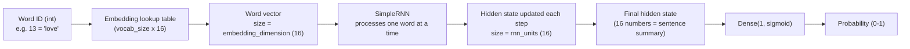
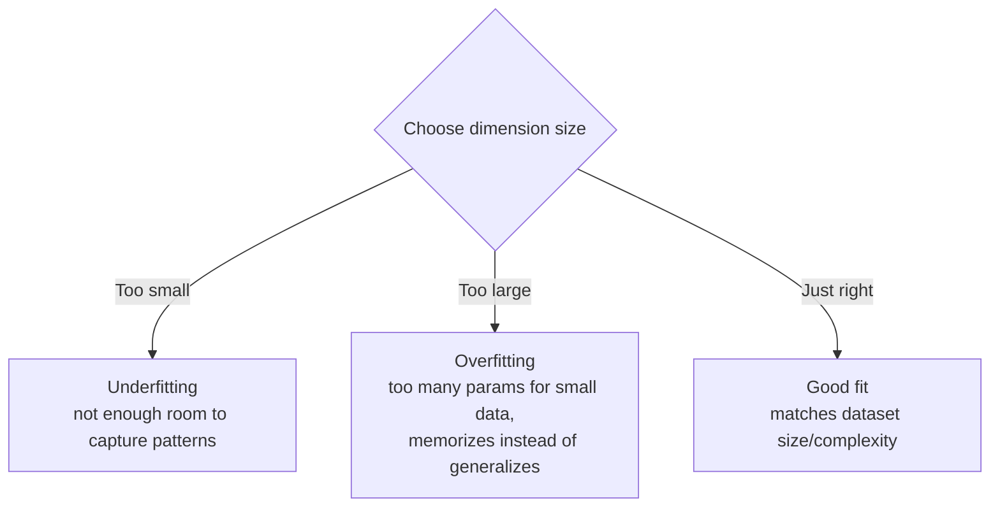
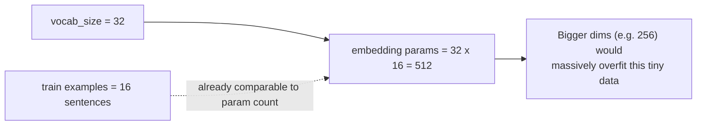

# `embedding_dimension` and `rnn_units` — Summary Notes

## What they are
Both are **hyperparameters** — chosen by you, not learned by training — that
control the *size/capacity* of two layers.

```python
embedding_dimension = 16
rnn_units = 16
```

| Parameter | Controls | Shape it defines |
|---|---|---|
| `embedding_dimension` | numbers used to represent **each word** | `Embedding` lookup table = `(vocab_size, 16)` |
| `rnn_units` | size of the RNN's **memory / hidden state** | hidden state vector = `(16,)`, updated every timestep |

## Data flow: how they connect



## Why size matters (capacity vs. overfitting trade-off)



## Why `16` was chosen here
Dataset = 20 sentences, 31 unique words → very small.



`16`/`16` is simply a **small, sensible starting point** matched to a toy-scale
dataset — not a value with special significance.

## Practical sizing guide

| Situation | Typical `embedding_dimension` / `rnn_units` |
|---|---|
| Toy/tiny dataset (this notebook) | 8 – 32 |
| Small real dataset (hundreds–thousands of examples) | 32 – 128 |
| Large real dataset (e.g. IMDB, 25k+ reviews) | 64 – 300 |

## One-line takeaway
> Both parameters trade off **model capacity** against **overfitting risk** —
> pick them relative to how much data and vocabulary complexity you actually
> have, then tune based on validation performance.
