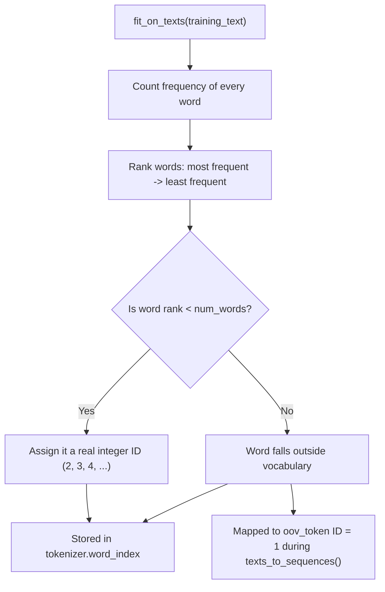
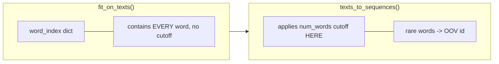
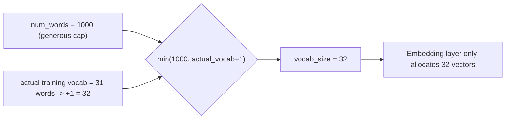

# `num_words` in Keras `Tokenizer` — Summary Notes

## What it is
`num_words` limits the tokenizer's vocabulary to the **top N most frequent words**
seen during `fit_on_texts()`. Words outside this limit are replaced by the
`oov_token` (Out-Of-Vocabulary) when converting text to sequences.

```python
tokenizer = Tokenizer(
    num_words=1000,
    oov_token="<OOV>"
)
```

- ID `0` → reserved for padding
- ID `1` → reserved for `<OOV>` (unknown words)
- IDs `2 ... num_words-1` → the most frequent real words

## Why it matters
| Without `num_words` limit | With `num_words` limit |
|---|---|
| Every unique word gets an ID (could be 50,000+) | Only common, informative words get IDs |
| Huge Embedding layer → more params, slower, overfits | Small Embedding layer → efficient, generalizes better |
| Rare words (typos, names) add noise | Rare words collapse into `<OOV>`, ignored as noise |

## Flow: how a word gets its ID



## Important subtlety
`tokenizer.word_index` stores **ALL** words seen, regardless of `num_words`.
The cutoff is only enforced later, in `texts_to_sequences()`.



## Applied to this notebook
```python
vocab_size = min(1000, len(tokenizer.word_index) + 1)
```



Since this dataset only has 31 unique words, `num_words=1000` never actually
kicks in — it's just a safe upper bound. The real limiting factor here is the
tiny dataset itself, not the `num_words` setting.

## One-line takeaway
> `num_words` is a **vocabulary-size control**: it keeps the model focused on
> common, meaningful words and treats rare/unseen words as `<OOV>`, keeping the
> Embedding layer small and the model less prone to overfitting.
